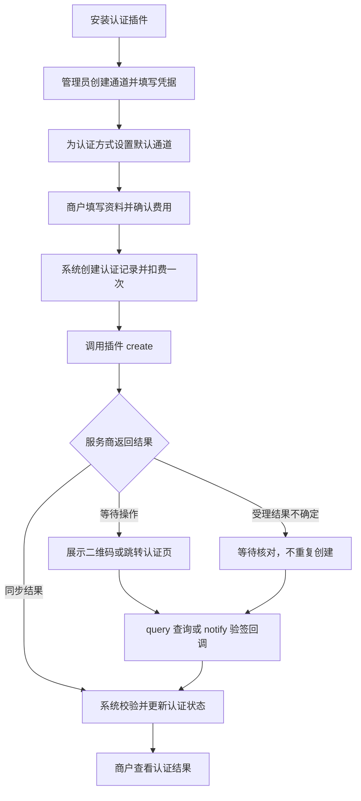

# 实名认证插件开发

适用于 **XArrPay 商户版 1.5.1.15 及以上版本**，协议版本为 `certificate v1`。认证插件使用 Lua 对接认证服务商，系统统一负责通道选择、表单展示、认证记录、费用与实名状态。

## 一、流程与职责



插件负责请求服务商、验证回调、转换结果。插件不能直接修改用户实名状态、扣款或退款。新增符合协议的服务商，只需实现插件并配置通道。

首期支持个人认证：

| 方式 | 标识 | 必需资料 |
|---|---|---|
| 人脸认证 | `face` | 姓名、身份证号 |
| 姓名证件核验 | `id_two_factor` | 姓名、身份证号 |
| 手机号三要素 | `mobile_three_factor` | 姓名、身份证号、手机号 |

企业认证、图片上传及原生 SDK 不在 v1 范围内。插件应如实声明认证方式，不得将姓名证件核验标成人脸认证。

## 二、插件包

每个插件包含以下文件，文件名保持一致：

```text
my_certificate/
├── manifest.json   # 插件名称、版本和类型
├── plugin.lua      # Lua 接入逻辑
└── logo.png        # 可选图标
```

`manifest.json` 示例：

```json
{
  "name": "my_certificate",
  "title": "示例实名认证",
  "author": "开发者名称",
  "description": "个人身份核验服务",
  "version": "1.0.0",
  "min_program_version": "1.5.1.15",
  "type": 7
}
```

`type` 固定为 **7**；插件名称使用小写字母开头的小写字母、数字和下划线，最长 64 字符，并与插件目录名一致。不要在插件包内保存商户私钥、实例密钥、个人资料或调试记录。

安装后，在后台应用管理中扫描并载入“实名认证插件”，再由超级管理员进入“系统设置 → 实名认证”创建通道。一个插件可以配置多个通道，每种方式使用一个启用的默认通道；无可用通道时会报错，不会自动切换到其他服务商。最后在基础设置中开启实名认证并设置费用。

## 三、能力声明与方法

`pluginInfo()` 返回普通 table，无需 `response.success` 包装：

```lua
function plugin.pluginInfo()
  return {
    certificate = {
      protocol_version = 1,          -- 当前协议版本
      methods = { "face" },          -- 实际支持的认证方式
      query = true,                 -- 支持主动查询
      notify = false,                -- 支持服务商回调时设为 true
      open = true,                  -- 扫码后按需生成认证地址
      synchronous = false,          -- 是否支持同步返回最终结果
      config_check = true,          -- 是否提供配置格式校验
      action_hosts = { "openapi.alipay.com" } -- 跳转目标的精确主机名
    }
  }
end
```

| 方法 | 是否必需 | 用途 |
|---|---|---|
| `pluginInfo()` | 必需 | 声明能力与协议版本 |
| `formItems(ctx)` | 必需 | 定义管理员配置表单 |
| `subjectForm(ctx)` | 必需 | 按 `ctx.method` 定义身份资料表单 |
| `create(ctx)` | 必需 | 提交一次认证申请 |
| `validateConfig(ctx)` | `config_check=true` 时必需 | 校验配置格式，不创建认证业务 |
| `query(ctx)` | `query=true` 时必需 | 查询已有申请，不能重新创建 |
| `notify(ctx)` | `notify=true` 时必需 | 验证签名和业务绑定，返回认证结果 |
| `open(ctx)` | `open=true` 时必需 | 扫码后获取服务商跳转地址 |

声明能力却未实现对应方法会导致加载失败。异步插件至少实现 `query` 或 `notify`；只有同步能力的插件不能返回 `pending`。

## 四、动态表单

表单方法统一返回 `{code=200, data={fields={...}}}`：

```lua
function plugin.formItems(ctx)
  return response.success({ fields = {
    { name = "app_id", label = "应用 ID", type = "input", required = true },
    { name = "private_key", label = "应用私钥", type = "textarea",
      required = true, secret = true } -- 凭据字段标记为敏感
  } })
end

function plugin.subjectForm(ctx)
  local fields = {
    { name = "real_name", label = "真实姓名", type = "input", required = true },
    { name = "id_card", label = "身份证号", type = "input", required = true }
  }
  if ctx.method == "mobile_three_factor" then
    fields[#fields + 1] = {
      name = "phone", label = "手机号", type = "input", required = true
    }
  end
  return response.success({ fields = fields })
end
```

| 字段 | 说明 |
|---|---|
| `name` | 提交键，小写字母开头，仅小写字母、数字和下划线，最长 64 字符 |
| `label` | 展示名称，必填 |
| `type` | 仅支持 `input`、`password`、`textarea` |
| `required` | 是否必填 |
| `secret` | 是否为敏感配置 |

每个表单支持 1～20 个字段，名称不能重复。身份表单仅允许 `real_name`、`id_card`、`phone`，不得额外收集个人资料。所有认证方式都要求有效姓名与身份证号；手机号三要素还要求有效手机号。

后台不回显已保存的凭据；编辑通道时留空表示保留原值。不要将凭据写入表单默认值、标签或提示文字。

## 五、调用上下文

除 `pluginInfo()` 外，方法只接收一个 `ctx` table。

| 属性 | 含义 |
|---|---|
| `request_id` | 系统认证单号，应传给服务商作为幂等业务单号 |
| `method` | 本次认证方式 |
| `channel_options` | 当前通道配置；已有记录使用创建时的配置快照 |
| `subject` | 仅 `create` 提供必要的姓名、证件号、手机号 |
| `provider_order_id` | 已保存的服务商认证编号 |
| `plugin_data` | 插件上次返回并由系统加密保存的数据 |
| `notify_url` | 创建时提供的服务商回调地址 |
| `return_url` | 创建时提供的浏览器返回地址 |

配置表单、身份表单及配置校验阶段并没有完整的认证订单上下文。后台恢复查询时可能没有站点地址；后续确实需要使用的地址，应在创建时放入 `plugin_data`。

`notify(ctx)` 额外收到：

| 属性 | 含义 |
|---|---|
| `body` | 原始请求体字符串，用于验签 |
| `headers` | HTTP 规范化名称的请求头，如 `Content-Type` |
| `query` | 已解析的查询参数 |
| `raw_query` | 未改写的原始查询串 |

验签应遵循服务商协议，保留原始报文，不能先解析再重编码后验签。

## 六、统一返回格式

除 `pluginInfo` 外，各方法返回 `{code,message,data}`。`code=200` 表示方法正常执行，**认证是否通过由 `data.status` 决定**。表单和配置校验使用各自数据结构，认证业务方法使用下列结果：

```lua
return response.success({
  status = "pending", -- 等待商户完成认证
  provider_order_id = "provider-order-id",
  next_action = {
    type = "redirect",
    content = "https://verify.example.com/session/opaque-token"
  },
  plugin_data = { session_id = "opaque-session-id" }, -- 后续调用需要的数据
  expires_at = 0 -- 0 表示使用系统有效期
})
```

示例域名仅用于说明，接入时应改为服务商真实地址，并加入 `action_hosts`。

| 结果字段 | 说明 |
|---|---|
| `status` | 仅允许 `pending`、`succeeded`、`failed` |
| `provider_order_id` | 服务商认证编号，最长 128 字符 |
| `request_id`、`method` | 回调必须返回并与原申请匹配 |
| `next_action` | 前端下一步动作，见下表 |
| `expires_at` | Unix 秒时间戳，只能缩短系统有效期 |
| `plugin_data` | 后续调用所需的数据，不下发给前端 |
| `not_accepted` | 服务商明确未受理；只能与 `failed` 一起返回 |
| `verified` | 回调签名已通过；不等于身份认证通过 |
| `ack` | 验签成功后给服务商的纯文本回执，最多 1024 字符 |

| 动作 | 规则 |
|---|---|
| `none` | 无额外操作，`content` 必须为空 |
| `wait` | 等待查询或回调，`content` 必须为空 |
| `qrcode` | 展示二维码，内容必须为允许的 HTTPS 地址 |
| `redirect` | 跳转到允许的 HTTPS 地址 |

地址必须使用 HTTPS，不含用户名密码，端口为默认或 443，主机名精确匹配 `action_hosts`。不支持通配域名、HTML 或 JavaScript。`open=true` 时，系统生成带短期凭证的本站二维码，扫描后才调用插件生成跳转地址。

系统默认最多等待一小时。返回结果最多 64 KiB。不要在 `message`、链接、回执或其他字段中包含身份证号、手机号、密钥或完整上游报文。

### 回调处理要求

1. 使用当前通道凭据验证服务商签名，按服务商协议校验时间戳、防重放信息。
2. 校验回调的业务单号、认证方式、服务商编号与当前申请一致。
3. 将服务商结果转换为标准状态，再返回以下结构。
4. 验签失败时返回错误，不能设置 `verified=true`。

以下仅表示**已完成验签和业务校验后的返回结构**，不能直接当作验签实现：

```lua
return response.success({
  verified = true,                 -- 仅在真实验签成功后设置
  request_id = ctx.request_id,
  method = ctx.method,
  provider_order_id = ctx.provider_order_id,
  status = "succeeded",           -- 必须由已验证的服务商结果转换
  next_action = { type = "none" },
  ack = "success"                  -- 按服务商要求返回纯文本
})
```

不得信任浏览器跳回或用户传入的 `success` 参数。浏览器返回只用于展示页面，不能作为认证成功依据。

## 七、完整参考：支付宝人脸认证

以下示例使用系统提供的专用支付宝能力，可与前面的元信息格式配合；插件名称改为 `alipay_face`。

```lua
---@diagnostic disable: undefined-global
package.path = package.path .. ";" .. luaCommonPath .. "/?.lua"
require("autoload")
local plugin = {}

-- 声明刷脸、查询和扫码后跳转能力。
function plugin.pluginInfo()
  return { certificate = {
    protocol_version = 1,
    methods = { "face" },
    config_check = true,
    query = true,
    open = true,
    action_hosts = { "openapi.alipay.com" }
  } }
end

-- 后台填写应用 ID 和密钥，密钥不在页面回显。
function plugin.formItems(ctx)
  return response.success({ fields = {
    { name = "app_id", label = "支付宝应用 ID", type = "input", required = true },
    { name = "private_key", label = "应用私钥", type = "textarea",
      required = true, secret = true },
    { name = "public_key", label = "支付宝公钥", type = "textarea",
      required = true, secret = true }
  } })
end

-- 商户只提交本次认证需要的姓名和身份证号。
function plugin.subjectForm(ctx)
  return response.success({ fields = {
    { name = "real_name", label = "真实姓名", type = "input", required = true },
    { name = "id_card", label = "身份证号", type = "input", required = true }
  } })
end

-- 校验配置格式，不创建服务商认证申请。
function plugin.validateConfig(ctx)
  return certificate.alipay("validate", ctx)
end

-- 创建一次申请，后续查询使用已有服务商编号。
function plugin.create(ctx)
  return certificate.alipay("create", ctx)
end

-- 查询结果，不重复提交身份资料。
function plugin.query(ctx)
  return certificate.alipay("query", ctx)
end

-- 商户扫码时才生成支付宝认证跳转地址。
function plugin.open(ctx)
  return certificate.alipay("open", ctx)
end

return plugin
```

`certificate.alipay` 仅支持 `validate`、`create`、`query`、`open`，使用本次调用的通道配置。对接其他服务商时，应替换对应方法的请求、签名和结果转换逻辑，不能调用此能力来模拟其他服务商认证。

## 八、收费、异常与恢复

- 费用由管理员配置，系统创建申请时扣费一次，插件不操作余额。
- 创建阶段只有明确返回 `status="failed"` 且 `not_accepted=true`，才作为未受理退款依据。必须有服务商可验证的未受理结论。
- 身份核验不通过不退款。请求超时、连接中断或结果不确定不能伪装成未受理。
- 受理结果不确定时，系统进入待核对状态，不会自动重提或退款。插件应使用 `request_id` 做上游幂等标识。
- 系统约每 30 秒恢复未结束记录，通过查询或可信回调核对结果；缺少服务商编号且无可信回调时，需要人工向服务商对账。
- 过期只表示本地流程关闭，不证明服务商没有受理。迟到结果不能覆盖已结束状态或管理员后续修改。

插件只返回三种标准业务状态；`submitting`、`unknown`、`expired`、`conflict` 等由系统管理，不能作为插件 `status` 返回。

## 九、运行环境与升级

认证插件可以使用 `json`、`url`、`crypto`、受限 `http`、`certificate` 及 `response`。认证环境中的 `autoload` 只加载这些能力，不能套用支付插件的完整内置函数清单。

不提供订单、余额和全局配置操作，也不提供 `os`、`io`、`debug`、任意磁盘加载、动态代码执行和 `print`。HTTP 请求强制 HTTPS 与证书验证，拒绝本机或私网目标，不自动跟随重定向，响应最多 2 MiB；调用及等待总时长最多 25 秒。只安装可信来源的插件。

升级步骤：

1. 停用相关通道，停止接收新申请。
2. 等待历史申请处理完毕，并核对结果不确定的记录。
3. 使用应用管理更新插件，再校验配置并启用通道。

活动申请会阻止插件停用、卸载或覆盖升级。不要直接替换使用中的 `plugin.lua`；系统会校验插件内容是否发生变化。已有记录继续使用创建时的配置快照。

通道凭据及业务快照由系统加密保存。多实例应使用一致的实例密钥，密钥与数据分开备份，不能放进插件包。遗失密钥应恢复原密钥，不能直接生成新密钥代替。

## 十、联调验收

| 场景 | 应验证的行为 |
|---|---|
| 正常认证 | 表单、扫码或跳转、查询、最终实名状态一致 |
| 同步核验 | 一次调用返回最终结果，不返回无后续查询能力的等待状态 |
| 错误配置 | 配置校验失败，不产生上游业务 |
| 重复提交与重复回调 | 不重复创建、扣费或退款 |
| 伪造回调或错单 | 拒绝更新实名状态 |
| 超时或进程中断 | 保持待核对，不自动重复创建 |
| 明确未受理 | 符合条件时仅退款一次 |
| 身份核验不通过 | 状态失败，不按未受理退款 |
| 过期及管理员修改后回调 | 不覆盖已结束记录或人工修改 |
| 通道切换与插件升级 | 新申请使用默认通道，历史申请可继续核对 |

上线前必须使用服务商可用账号完成真实认证验收，模拟响应不能替代真实扫码与服务商回调验证。
